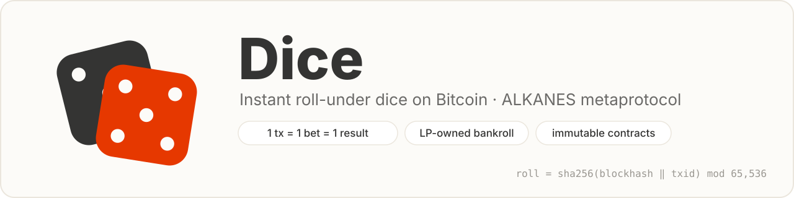
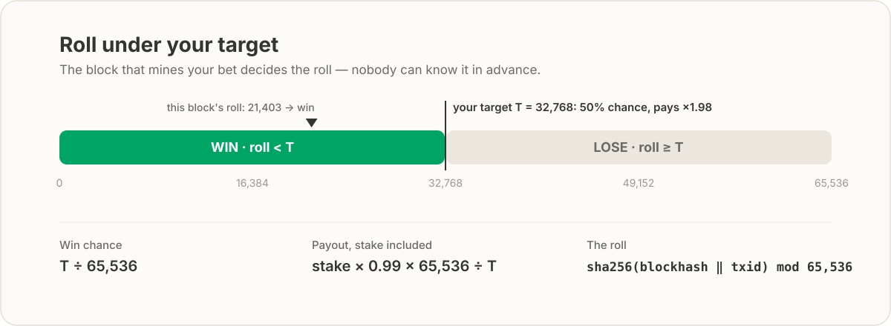
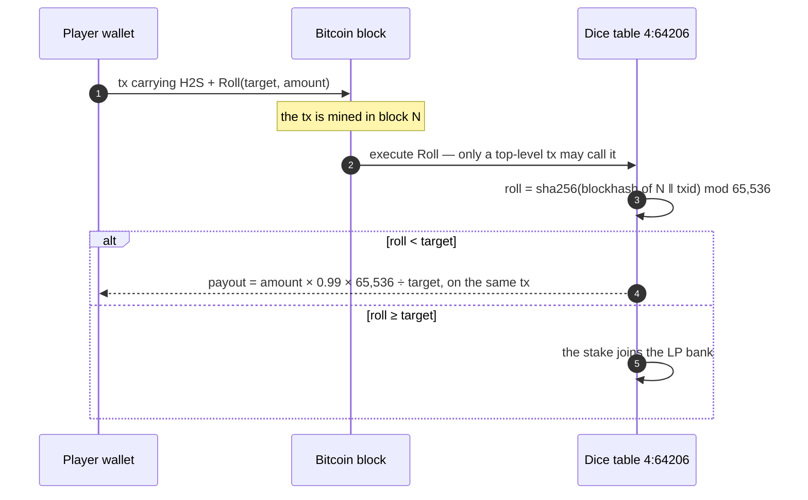
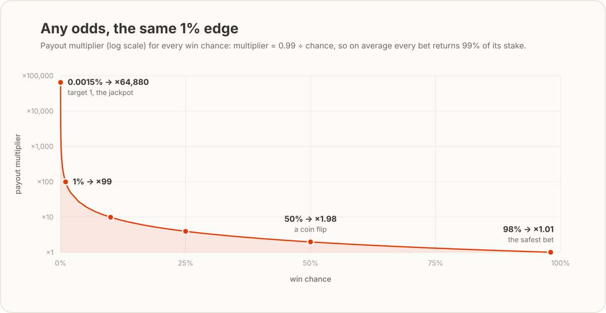
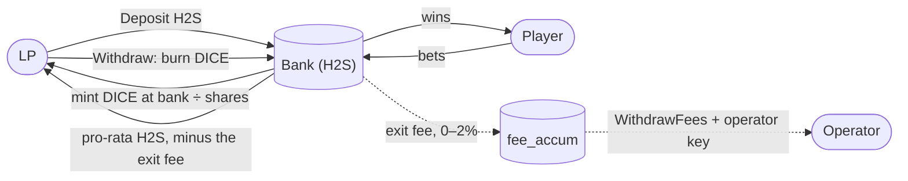
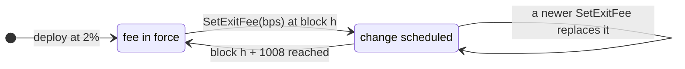
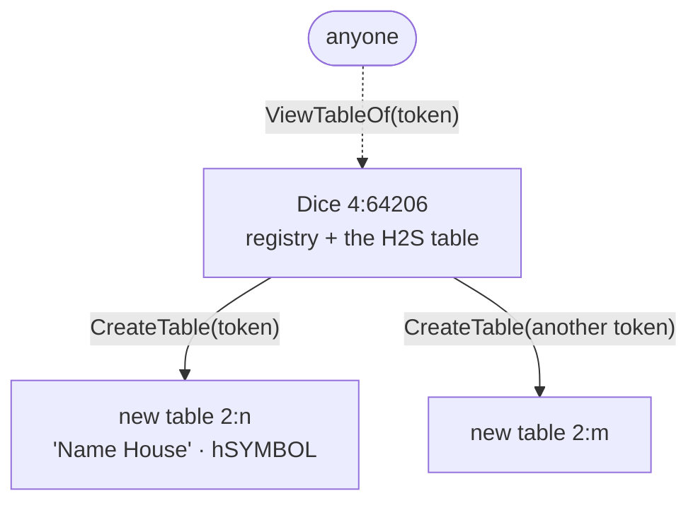

<p align="center">
  <picture>
    <source media="(prefers-color-scheme: dark)" srcset="docs/img/banner-dark.svg">
    
  </picture>
</p>

<p align="center">
  <a href="#mainnet"></a>
  
  
  
</p>

**Dice** is an instant roll-under dice game on Bitcoin, built on the
[ALKANES](https://github.com/kungfuflex/alkanes-rs) metaprotocol. Pick a target,
send a bet, and the block that mines it rolls the dice: the result is
`sha256(blockhash ‖ txid)` of that block, and a win is paid out on the bet's own
transaction. No rounds, no claims, no waiting.

The bankroll belongs to its liquidity providers. LPs deposit into the bank, get
DICE shares and earn the whole 1% house edge, while caps derived from the Kelly
criterion keep any run of wins from draining the bank — so LPs come out ahead in
the long run. Every rule is compiled into immutable contracts: no upgrade path,
no pause switch, no admin key over the game or its funds.

<p align="center">
  <a href="#mainnet">Mainnet</a> ·
  <a href="#how-a-bet-works">How a bet works</a> ·
  <a href="#pick-your-odds">Odds</a> ·
  <a href="#the-house-is-the-lps">LPs</a> ·
  <a href="#why-the-bank-cant-be-drained">Safety</a> ·
  <a href="#the-operator-and-the-exit-fee">Operator</a> ·
  <a href="#a-table-for-any-token">Tables</a> ·
  <a href="#contract-interface">Interface</a> ·
  <a href="#build-test-verify">Build</a>
</p>

## At a glance

| | |
|---|---|
| **House edge** | 1%, fixed forever — all of it goes to LPs; players pay no other fee |
| **Odds** | any win chance from **0.0015%** to **98%** — pays **×64,880** down to **×1.01** |
| **Settlement** | instant, inside the bet's own transaction |
| **Randomness** | `sha256(blockhash ‖ txid)` of the mining block — the recipe [ord#4541](https://github.com/ordinals/ord/pull/4541) canonized for runes |
| **Biggest win per bet** | 1% of the bank, net (full Kelly) |
| **Most paid per block** | 20% of the bank, net |
| **LP exit fee** | 0–2%, never more; every change is announced ~1 week (1008 blocks) ahead |
| **Admin** | none over the game: the operator key only collects the exit fee and tunes it within 0–2% |

## Mainnet

| Contract | Alkane | Deployed |
|---|---|---|
| **Dice** — the main table, the table registry and the template every other table clones | **`4:64206`** | block 969,539 · [tx](https://mempool.space/tx/8b30ecaca8c8f80f0a13f26e2955aecd6a51db626e7f681f6feeb1ae3f17be79) |
| **Dice Operator** — the fee key, 3 interchangeable units | **`4:57005`** | block 969,541 · [tx](https://mempool.space/tx/319e4471c391858d875f6348b3af027723af32d0c8b6745d95b5409d0aa661ea) |

The main table plays in **FARTANE** (`2:69`, symbol **H2S**); its LP shares are
**DICE** (`4:64206` itself). The deployed bytecode is reproducible from commit
[`452d0a1`](https://github.com/Misha-btc/dice/commit/452d0a1) — see
[Build, test, verify](#build-test-verify) and
[`deployments/mainnet.env`](deployments/mainnet.env).

## How a bet works

<p align="center">
  <picture>
    <source media="(prefers-color-scheme: dark)" srcset="docs/img/roll-under-dark.svg">
    
  </picture>
</p>

You choose a **target** `T` between 1 and 64,238. The block that mines your
transaction produces a **roll** between 0 and 65,535; if the roll is **below**
`T`, you win `stake × 0.99 × 65,536 ÷ T` (your stake included). Nobody — not you,
not the house — can know the roll before the block exists.



- **One transaction, one result.** The roll, the payout and any change all land
  in the transaction that carries the bet.
- **Too big? Clamped, not rejected.** A bet larger than the caps allow right now
  is resized down and the excess handed back; set `min_amount` to make it
  all-or-nothing instead.
- **`amount = 0` bets everything you sent** — the mint-and-roll flow: chain a
  free mint into a Roll without knowing the mint's size in advance.

## Pick your odds

<p align="center">
  <picture>
    <source media="(prefers-color-scheme: dark)" srcset="docs/img/odds-dark.svg">
    
  </picture>
</p>

Every target carries the same 1% edge, so the only thing you choose is variance.
The bank caps each bet at a **net win of 1% of the bank**, which is why longshots
come with smaller maximum stakes:

| Win chance | Target `T` | Pays | Biggest stake allowed |
|---:|---:|---:|---:|
| 98% | 64,238 | ×1.01 | ≈ the whole bank (net win 1%) |
| 75% | 49,152 | ×1.32 | 3.13% of the bank |
| 50% | 32,768 | ×1.98 | 1.02% of the bank |
| 25% | 16,384 | ×3.96 | 0.34% of the bank |
| 10% | 6,554 | ×9.90 | 0.11% of the bank |
| 1% | 655 | ×99.05 | 0.0102% of the bank |
| 0.0015% | 1 | ×64,880 | 0.000015% of the bank |

The minimum bet is 1,000 base units, so the extreme targets become playable as
the bank grows. `ViewMaxBet(target)` returns the live limit.

## The house is the LPs



- **Deposit** the table's token and receive **DICE** shares at the current
  `bank ÷ shares` price. Losing bets — the edge on average — grow the bank, and
  with it the value of every share.
- **Withdraw any time**, pro-rata. Bets settle instantly, so the bank never owes
  anything to anyone in flight: there is nothing to wait for.
- **Donate** grows the bank without minting shares — a gift to current LPs.
- A virtual offset in the share price (the ERC-4626 defence) makes the
  first-depositor inflation attack a guaranteed loss for the attacker.

## Why the bank can't be drained

- **Full-Kelly cap.** A single bet can win at most **1% of the bank**, net, at any
  odds. That is the growth-optimal fraction: the bank's expected log-growth stays
  positive and it never goes broke (proven in the math crate, including a
  200,000-bet simulation and 1,000 consecutive maximum wins).
- **Block budget.** At most **20% of the bank** is paid out per block, net. Within
  one block, rolls never take the bank below 80% of where it started — a miner
  who stuffs a block with winning bets is capped.
- **One roll per transaction per table.** Every Roll in a transaction would share
  one roll, so a second one reverts with a full refund instead of stacking into
  one oversized bet.
- **Top-level only.** Roll refuses calls from other contracts, so nobody can wrap
  it and revert the losing outcomes.
- **Exact arithmetic.** Rounding always favours the bank, and nothing silently
  wraps around u128: an impossible deposit reverts, an impossible payout is
  clamped to the cap.

> **Miner caveat (accepted).** A miner who finds a block can withhold it if its
> rolls lose them money. Doing so forfeits the block reward, and the 20% budget
> caps what any single block can take.

## The operator and the exit fee

Players pay nothing beyond the 1% edge. The operator's only income is the
**exit fee** an LP pays when withdrawing: up to **2%**, a ceiling compiled into
the contract that nobody can raise.

- **Every change waits 1008 blocks (~a week)** before it applies — up or down.
  LPs always see a new fee coming and can leave at the old one first.
  `ViewExitFee` shows the countdown.
- The fee accrues per table in its own token and is collected with
  `WithdrawFees`, which never touches the bank or LP shares.
- Access is the **Dice Operator** key, `4:57005`. Three interchangeable units
  were minted once — one to use, two spares — and any one of them is enough.
  Losing all three would only freeze future fee collection: LP and player flows
  never touch the key.



## A table for any token



- Anyone can open a table for any alkane with `CreateTable`. Each table is an
  independent clone with its own bank, its own shares and its own exit fee, born
  empty until its first deposit.
- **One canonical table per token, forever** — the registry entry can never be
  overwritten, and frontends find tables through `ViewTableOf`.
- Shares are named after the token automatically: a token called "Brick" (BRICK)
  gets a table whose shares read **"Brick House" / hBRICK**.

## Contract interface

`Dice` (`4:64206`; every table answers the same opcodes):

| Opcode | Call | What it does |
|---:|---|---|
| 1 | `Roll(target, amount, min_amount)` | the bet; clamps to the caps, `amount = 0` bets everything sent; returns `(roll, win, payout, effective_amount)` |
| 2 | `Deposit(amount)` | token in → DICE shares out |
| 3 | `Withdraw(shares, min_payout)` | DICE in → pro-rata token out, minus the exit fee; `min_payout` is a slippage floor |
| 4 | `CreateTable(token_block, token_tx)` | open the canonical table for a token (registry only) |
| 5 | `Donate(amount)` | grow the bank, mint nothing |
| 6 | `WithdrawFees` | operator key: collect this table's accrued exit fees |
| 7 | `SetExitFee(bps)` | operator key: schedule a new fee, 0–200 bps, live 1008 blocks later |
| 99 / 100 | `GetName` / `GetSymbol` | "Dice" / "DICE" for the main table |
| 101 | `ViewBank` | `(bank, total_shares, fee_accum, exit_bps)` |
| 102 | `ViewStats` | `(total_bets, total_wagered, total_won)` |
| 103 | `ViewConfig` | `(min_bet, edge_bps, t_min, t_max, token_block, token_tx, exit_bps_max)` |
| 104 | `ViewMaxBet(target)` | `(max_bet, max_net_profit)` at the current bank |
| 105 | `ViewTableOf(token_block, token_tx)` | the canonical table for a token, zeros if none |
| 106 | `ViewExitFee` | `(fee_now, fee_next, activation_height, delay)` |

Calls are protostone cellpacks, e.g. a coin-flip bet of 1,000,000 H2S base units
is `[4,64206,1,32768,1000000,0]` with the H2S attached. Full design notes,
including the Kelly derivation: [`docs/SPEC.md`](docs/SPEC.md).

## Try it

Read the live mainnet table — views only, no wallet needed:

```bash
RPC_URL=https://mainnet.subfrost.io/v4/subfrost ./scripts/view.sh bank
```

`view.sh` also takes `stats`, `config`, `exit-fee`, `max-bet <target>` and
`table-of <block> <tx>`. The other scripts (`deposit.sh`, `roll.sh`,
`withdraw.sh`, …) drive a local regtest; `scripts/deploy-mainnet.sh` is the
hardened two-step deploy that put this table on mainnet.

## Build, test, verify

```bash
cargo test -p dice-math                 # 28 tests: payouts, Kelly caps, no-ruin sims, share pricing
./scripts/build-wasms.sh                # reproducible wasm, pinned toolchain (rust-toolchain.toml)
cargo test --lib -- --test-threads=1    # 31 integration tests on the real alkanes runtime
```

The build strips every machine-local path, so anyone can check the mainnet
bytecode: check out `452d0a1`, run `./scripts/build-wasms.sh` (rustc
`nightly-2026-03-21`, Homebrew clang 20.1.4) and compare:

| wasm | sha256 |
|---|---|
| `dice_game.wasm` | `5475f1f1f18c9c0b81d681b02538ed2fa950c7acb1435d26a895e533ba5e8b60` |
| `dice_operator.wasm` | `92a4ef9cee33d86c17dfc53fab6722017c5ca7b8ffa959e43990f244dbc4def0` |

## Repository

```
alkanes/dice-game            the game contract (a thin wrapper)
alkanes/dice-game-runtime    all of the game logic
alkanes/dice-operator        the operator key contract
crates/dice-math             payouts, caps and share pricing, as pure math
src/tests                    integration tests on the alkanes harness
scripts                      build, deploy and regtest helpers
docs/SPEC.md                 the design document — start here
```

## Status and risks

- **Live on Bitcoin mainnet** since block 969,539. The contracts are immutable:
  no upgrade can fix a bug and none can take funds. The findings of an external
  review (2026-09-30) were fixed before launch and are covered by tests — see
  the SPEC.
- **This is a game of chance.** On average a bet returns 99% of its stake, and a
  bank can go through deep drawdowns before the edge shows — LPs carry that
  variance. Nothing here is financial advice.

Sister project of [Fireball / arbuzino](https://arbuzino.com): the same
immutable-by-design approach and tooling, no shared state at runtime.
